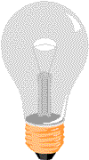
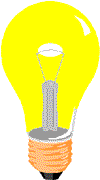
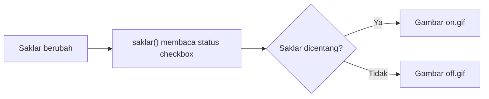

# Cetrek Cetrek Lampu

Latihan JavaScript DOM dari **CuyUniversity Sesi 4**. Halaman ini menampilkan tiga lampu dengan saklar masing-masing. Saat saklar diklik, gambar lampu berubah mengikuti status saklarnya.

[Cara menjalankan](#cara-menjalankan) · [Cara kerja](#cara-kerja) · [GitHub Pages](#github-pages)

## Pratinjau

| Lampu mati | Lampu menyala |
| --- | --- |
|  |  |

## Fitur

- Tiga saklar yang bisa digunakan secara terpisah.
- Perubahan gambar menyala dan mati berdasarkan status checkbox.
- Halaman statis yang bisa dibuka langsung di browser dan dipublikasikan melalui GitHub Pages.

## Cara menjalankan

1. Unduh proyek dari GitHub melalui **Code → Download ZIP**, lalu ekstrak.
2. Buka `index.html` di browser dengan JavaScript aktif.
3. Nyalakan salah satu lampu, lalu matikan kembali. Coba saklar lain untuk melihat bahwa tiap lampu mengikuti saklarnya sendiri.

Koneksi internet diperlukan untuk memuat **Tailwind CSS** dan **Flowbite** dari jsDelivr. Logika saklar dan gambar GIF tersedia di dalam proyek.

## Cara kerja

Setiap saklar adalah checkbox yang terhubung ke fungsi `saklar()` melalui event `change`. Fungsi tersebut membaca nilai `.checked` dari ketiga checkbox dan menetapkan `src` pada gambar yang sesuai. Saklar yang dicentang memakai `on.gif`. Saklar lain memakai `off.gif`.



Latihan ini memperkenalkan cara mengambil elemen dengan `document.getElementById()`, membaca input pengguna, dan memperbarui atribut elemen melalui DOM.

## Teknologi

| Teknologi | Kegunaan |
| --- | --- |
| HTML | Menyusun gambar dan tiga checkbox saklar. |
| JavaScript | Membaca status checkbox dan mengganti gambar lampu. |
| Tailwind CSS 4 dan Flowbite 3.1.2 | Menyediakan gaya antarmuka melalui CDN. |

## Struktur folder

```text
cetrek-cetrek-lampu/
├── index.html
├── saklar.js
├── README.md
└── ASSETS/
    └── images/
        ├── off.gif
        └── on.gif
```

## GitHub Pages

Setelah mengirim proyek ke branch `main` pada repo publik, buka **Settings → Pages**. Pilih **Deploy from a branch**, pilih `main` dan `/(root)`, lalu klik **Save**. Buka tautan yang muncul setelah publikasi selesai dan coba ketiga saklar. [Panduan GitHub Pages](https://docs.github.com/en/pages/getting-started-with-github-pages/configuring-a-publishing-source-for-your-github-pages-site)

Jika gambar tidak muncul, cocokkan nama folder dan file dengan struktur di atas. Pertahankan huruf besar pada `ASSETS` agar sesuai dengan path di HTML dan JavaScript. Jika gaya halaman tidak termuat, periksa koneksi ke jsDelivr.

## Kredit

Dibuat sebagai latihan dari materi CuyUniversity Sesi 4, *Cetrak Cetrek Lampu JavaScript*.
